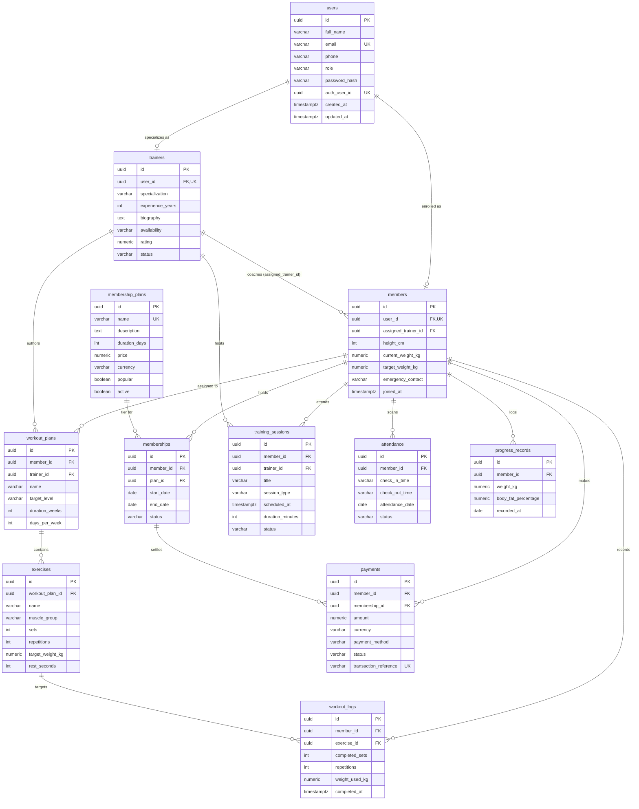

# FitSync — Supabase PostgreSQL Database Setup & Integration Guide

This guide provides complete instructions for setting up, configuring, and verifying the **Supabase PostgreSQL database** for the **FitSync Gym Tracker & Trainer Management System**, connecting it with the **Java Spring Boot 3.x** backend and **React TypeScript** frontend.

---

## 1. Architecture Overview & Entity-Relationship Diagram (ERD)

FitSync uses a normalized relational model consisting of **12 interconnected tables** with standard **UUID** primary keys, strict foreign key constraints, field validations, role escalation triggers, and Supabase Row Level Security (RLS).

### Entity-Relationship Diagram



---

## 2. Setting Up Supabase

### Step 1: Create a Supabase Project
1. Log in to [Supabase Console](https://supabase.com/dashboard).
2. Click **"New Project"**.
3. Choose an Organization, enter a project name (e.g. `fitsync-gym-tracker`), choose a region close to your users (e.g. `US East (N. Virginia)`), and choose a strong Database Password.
4. Save the database password securely; you will need it for the Spring Boot backend connection.

### Step 2: Retrieve Connection Details
1. In the Supabase Dashboard, go to **Project Settings** -> **Database**.
2. Scroll to the **Connection parameters** / **Connection string** section.
3. Select **URI** mode:
   - **Session Pooler (Port 5432)** *(Recommended for Spring Boot)*:
     ```text
     jdbc:postgresql://aws-0-<region>.pooler.supabase.com:5432/postgres?sslmode=require
     ```
     Username: `postgres.<project-ref>`
   - **Direct Connection (Port 5432)**:
     ```text
     jdbc:postgresql://db.<project-ref>.supabase.co:5432/postgres?sslmode=require
     ```
     Username: `postgres`
     *Note: Requires an IPv6-compatible network or the Supabase IPv4 Add-On.*
   - **Transaction Pooler (Port 6543)**:
     Suitable for serverless lambdas. *If used with Spring Boot, add `&prepareThreshold=0` to disable prepared statement caching.*

---

## 3. Applying Database Migrations

You can apply the database schema using either of two methods:

### Method A: Supabase SQL Editor (Fastest & Zero Setup)
1. Open your Supabase Dashboard and click **SQL Editor** from the left navigation bar.
2. Click **"New Query"**.
3. Copy the entire contents of [`database/supabase_complete_setup.sql`](file:///Users/niharika/Desktop/Fitsync/database/supabase_complete_setup.sql).
4. Paste it into the SQL editor and click **Run**.
5. Once completed, all 12 tables, indexes, role escalation triggers, and Row Level Security policies are active.
6. To load sample mock data for testing, create another query, copy [`database/seed_data.sql`](file:///Users/niharika/Desktop/Fitsync/database/seed_data.sql), and click **Run**.

### Method B: Spring Boot Flyway Migrations (Automated CI/CD)
The backend project has Flyway enabled out of the box in [`backend/src/main/resources/application.yml`](file:///Users/niharika/Desktop/Fitsync/backend/src/main/resources/application.yml).

The migration files are organized sequentially:
1. `V1__create_users_and_profiles.sql`: `users`, `trainers`, `members`
2. `V2__create_membership_tables.sql`: `membership_plans`, `memberships`
3. `V3__create_workout_tables.sql`: `workout_plans`, `exercises`, `workout_logs`, `training_sessions`
4. `V4__create_attendance_payments_progress.sql`: `attendance`, `payments`, `progress_records`
5. `V5__create_indexes_constraints_and_policies.sql`: Foreign key and filter indexes, role escalation trigger, and RLS policies

When you start the Spring Boot backend with your Supabase credentials, Flyway will run all 5 migrations in order.

---

## 4. Configuring Spring Boot Backend

Create a `.env` file in the `backend/` directory or set the environment variables:

```bash
# backend/.env
PORT=8080
FRONTEND_ORIGIN=http://localhost:3000,http://localhost:5173

# Supabase Session Pooler (Port 5432 with sslmode=require)
SUPABASE_DB_URL=jdbc:postgresql://aws-0-us-east-1.pooler.supabase.com:5432/postgres?sslmode=require
SUPABASE_DB_USERNAME=postgres.your_supabase_project_ref
SUPABASE_DB_PASSWORD=your_actual_supabase_password

# JWT Security
JWT_SECRET=fitsync_super_secret_jwt_encryption_key_2026_production_grade_32_chars_minimum
JWT_EXPIRATION_MS=86400000
```

### HikariCP Connection Pool Best Practices for Supabase
In [`application.yml`](file:///Users/niharika/Desktop/Fitsync/backend/src/main/resources/application.yml), HikariCP is pre-configured for Supabase poolers:
- `maximum-pool-size: 10`: Prevents exhausting database pooler slots.
- `minimum-idle: 2`: Keeps ready connections active.
- `idle-timeout: 300000` (5 minutes): Drops inactive connections cleanly.
- `max-lifetime: 1200000` (20 minutes): Rotates connections before Supabase idle cutoffs.
- `connection-timeout: 20000` (20 seconds): Avoids thread starvation during network latency.
- `ddl-auto: validate`: Validates JPA entities against Flyway-managed schema without altering tables.

---

## 5. Security & Data Integrity Highlights

| Feature | Implementation | Purpose |
|---|---|---|
| **Primary Keys** | `UUID DEFAULT gen_random_uuid()` | Prevents sequential ID guessing; 100% compatible with Supabase Auth |
| **Dual Authentication** | `password_hash` + `auth_user_id` | Allows native Spring Security BCrypt login or direct Supabase Auth JWT |
| **Financial Accuracy** | `NUMERIC(10, 2)` + `CHECK (amount >= 0.00)` | Eliminates floating-point rounding errors on payments and pricing |
| **Data Sanity** | CHECK constraints on weight, height, reps, sets | Prevents negative or nonsensical workout logs and weigh-ins |
| **Duplicate Prevention** | `UNIQUE(member_id, attendance_date, check_in_time)` | Prevents accidental duplicate gym check-ins |
| **Progress Over Time** | `UNIQUE(member_id, recorded_at)` | Enforces one authoritative body metric log per member per date |
| **Role Escalation Protection** | `trg_prevent_role_escalation` trigger | Blocks users from elevating their role to `ADMIN` |
| **Row Level Security (RLS)** | Enabled on all 12 tables with policies | Restricts data access: members see only their data, trainers see assigned athletes, admins see all |

---

## 6. Pre-Configured Test Accounts (Seed Data)

After running [`database/seed_data.sql`](file:///Users/niharika/Desktop/Fitsync/database/seed_data.sql), the following verified accounts are ready:

| Role | Name | Email | Password | Assigned Details |
|---|---|---|---|---|
| **ADMIN** | Alex Vance | `admin@fitsync.com` | `admin123` | Full administrative control |
| **TRAINER** | Marcus Hayes | `trainer@fitsync.com` | `trainer123` | Hypertrophy & Strength coach |
| **TRAINER** | Elena Rostova | `elena.rostova@fitsync.com` | `trainer123` | Functional & HIIT coach |
| **MEMBER** | Sarah Connor | `member@fitsync.com` | `member123` | Assigned to Marcus Hayes |
| **MEMBER** | James Rodriguez | `j.rodriguez@email.com` | `member123` | Assigned to Marcus Hayes |
| **MEMBER** | Emily Watson | `emily.w@email.com` | `member123` | Assigned to Elena Rostova |
| **MEMBER** | Liam Neeson | `liam.n@email.com` | `member123` | Self-guided (no trainer) |
| **MEMBER** | Sophia Martinez | `sophia.m@email.com` | `member123` | Assigned to Elena Rostova |

---

## 7. Verification & Diagnostics

Run [`database/verification_queries.sql`](file:///Users/niharika/Desktop/Fitsync/database/verification_queries.sql) in the Supabase SQL Editor to test:
1. All 12 tables exist with their respective column counts.
2. Foreign key relationships and cascade rules are properly wired.
3. Performance indexes are active on all FKs and query columns.
4. Check constraints are enforced.
5. Row Level Security is active (`relrowsecurity = true` on all 12 tables).
6. Total verified revenue calculation sums only `COMPLETED` payments.
7. Active memberships and expiring renewals calculate properly.

---

## 8. Resetting the Database (Development Only)

If you ever need to wipe the database and start fresh during development:
1. Execute [`database/reset_database.sql`](file:///Users/niharika/Desktop/Fitsync/database/reset_database.sql) in the Supabase SQL Editor.
2. Re-run [`database/supabase_complete_setup.sql`](file:///Users/niharika/Desktop/Fitsync/database/supabase_complete_setup.sql).
